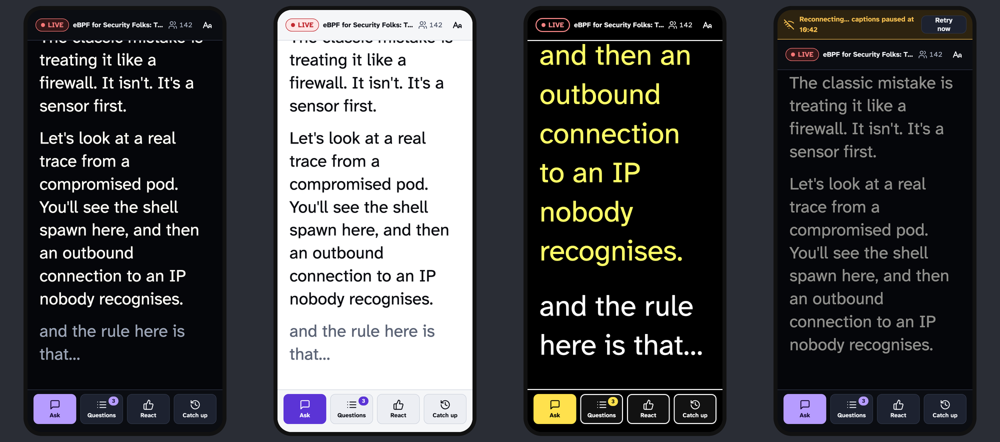
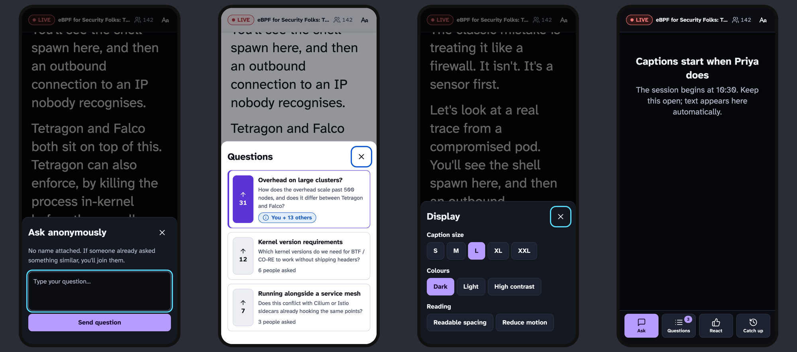
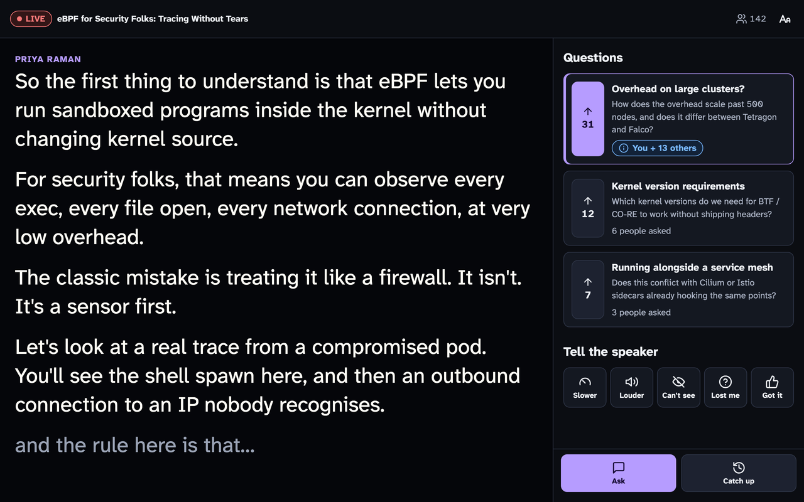
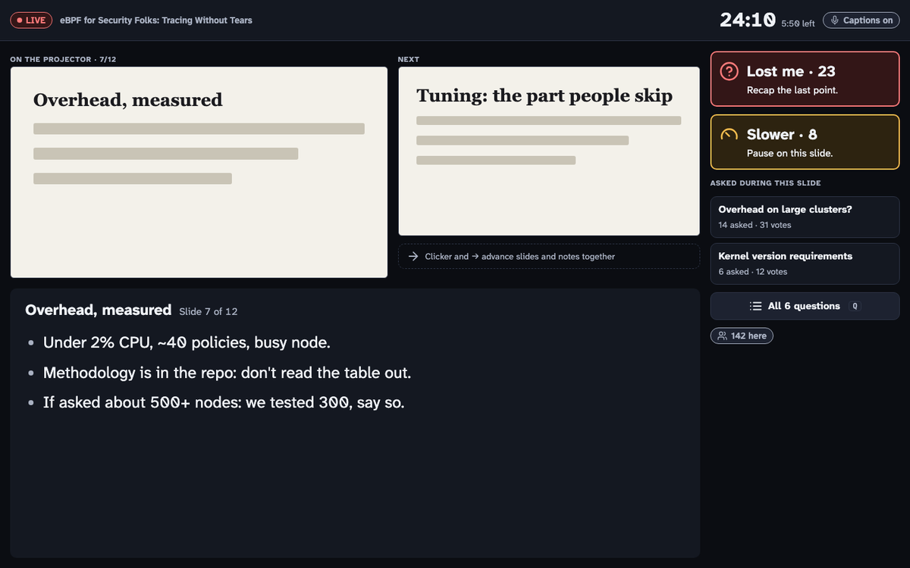
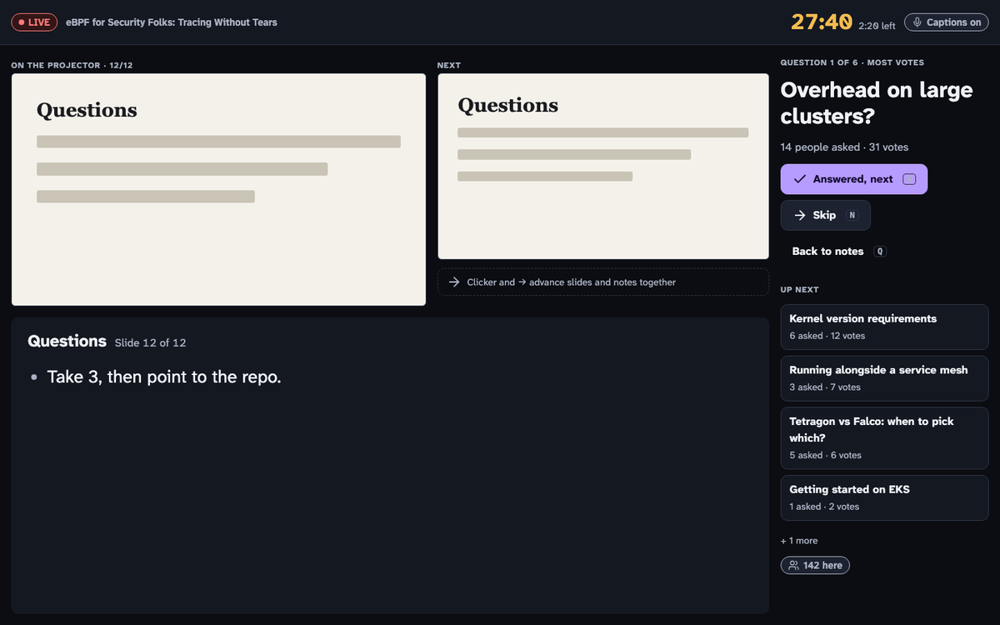
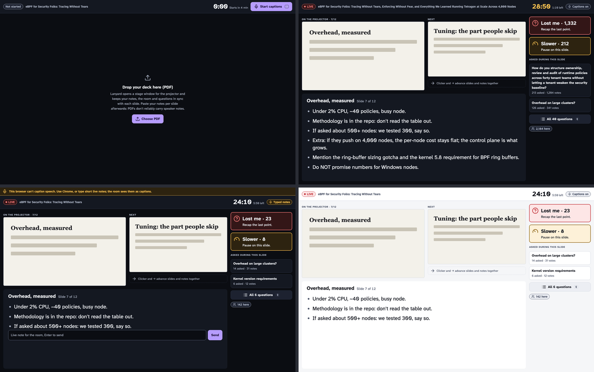
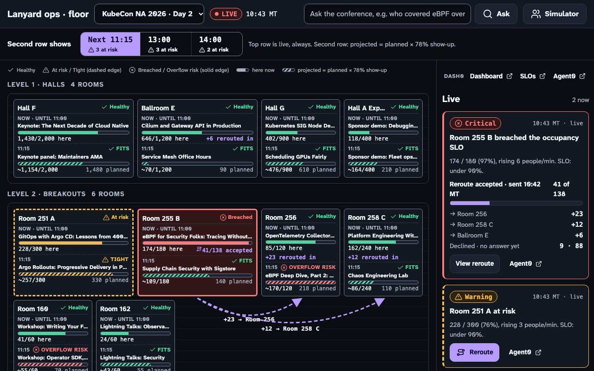
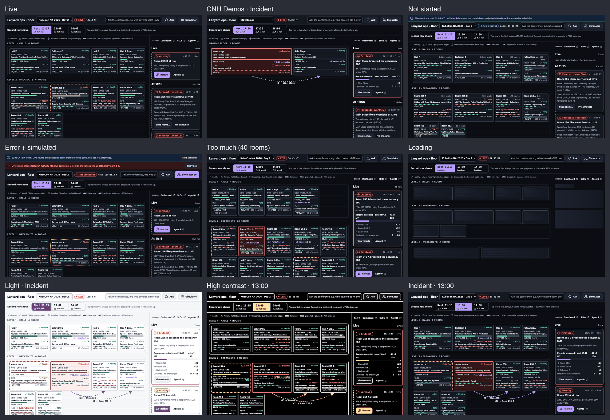
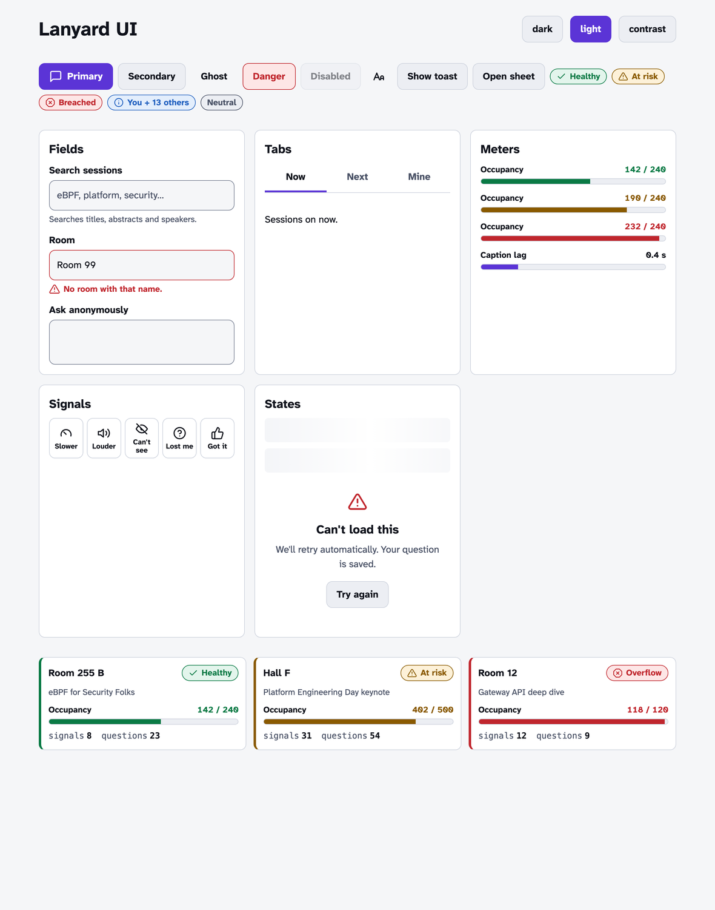

# Lanyard design

Lanyard is read on a phone in a dim room, a few seconds after someone scans a QR code, and on a projector from ten metres away. Some of the people reading it can't hear the speaker. Every rule here follows from that.

**Decided direction: A, "Caption stage".** Reading is the job. Captions own the whole screen. Ask, questions, reactions and catch-up are one thumb away in a bottom dock and open in sheets. On a laptop, questions and reactions move into a side panel beside the captions. The four rejected directions, and the reasons, are in [`docs/decision-log.md`](docs/decision-log.md). The round 1 prototype with all five is [`docs/design/grill.html`](docs/design/grill.html).

Code: [`apps/web/src/ui/`](apps/web/src/ui/). Usage notes for persona agents: [`apps/web/src/ui/README.md`](apps/web/src/ui/README.md).

## Principles

In priority order. When two conflict, the higher one wins.

1. **Captions are never squeezed.** On the live-session screen, the caption column keeps the full height and an uninterrupted flow at every caption size, up to XXL. Nothing is interleaved with caption text, and nothing permanent sits on top of it. This is the constraint that killed B, C, D and E.
2. **Accessible by default, not by setting.** The default view already passes WCAG 2.2 AA; most text pairs reach AAA (7:1). Settings (caption size, high contrast, readable spacing, reduced motion) make it better for a specific person; they don't make it usable.
3. **Colour is never the only signal.** Every status has text, and an icon by default. Room tiles show state three ways: edge colour, icon, word.
4. **One tap to act, zero forms to join.** Every participation action is a single tap from the live screen. Sending a signal or a question confirms with a toast saying what happened ("Merged: you and 13 others asked this").
5. **Dark first, light equal.** Dark is the default for the stage and the room. Light and high contrast are designed, not inverted.
6. **Small.** Plain CSS custom properties, about 20 components, one self-hosted font family. The UI CSS is 4.4 kB gzipped.

## Screens

### Attendee live session (phone), direction A

Dark, light, high contrast at XXL, and reconnecting:

The ask sheet (focus goes straight to the question box), questions in light, display settings, and before the session starts:

On a laptop, the side panel shows questions and signals. The dock keeps only Ask and Catch up:

### Speaker console (laptop), direction E

Decided in two rounds (see the decision log). The speaker console is **private**: only the speaker sees it, on the laptop or a confidence monitor. Lanyard owns the deck. The console shows the current and next slide, large notes for this slide, and a rail with room cues and the questions asked during this slide. A separate stage window puts the slide and the join QR on the projector.

Q&A mode turns the rail into a one-at-a-time queue. Not started, a 2,000-person spike, no speech API (typed live notes), and light:

- Room cues reuse the attendee signal thresholds: warn at 5% of the room in the last 60 s, crit at 15%. Each cue shows an icon, a count and a one-line suggestion ("Recap the last point"). "Got it" is never an alert.
- Time elapsed and time left sit top right; time left turns amber in the last 3 minutes.
- Keyboard: arrow keys and Page Up/Down (clicker) step slides, Q toggles Q&A, A marks answered, N skips.

### Organizer ops board (laptop), floor plan with a time scrubber

Decided in three rounds (see the decision log). Rooms sit on a floor plan as services. The top row of each tile is always live: session, check-ins and SLO state, shown as an edge colour, icon and word. The second row follows the time scrubber and shows projected attendance for the chosen slot (live bars are solid; projected bars are striped). A reroute draws walking paths to the rooms with seats.

- Use `RoomTile`'s states and thresholds: occupancy at risk at 75%, breached at 90%. A tile needs a second row for the scrubbed slot; add it to `RoomTile` as a prop rather than building a new tile.
- Dashed edge: at risk or tight. Solid edge: breached or overflow risk. Always with the word.
- Anything simulated is labelled **SIMULATED** on every view it touches.

### Components

## Tokens

All in [`apps/web/src/ui/tokens.css`](apps/web/src/ui/tokens.css). Persona code uses `var(--…)` and never raw values.

| Group | Tokens | Notes |
| --- | --- | --- |
| Colour | `--color-bg`, `surface`, `surface-2`, `border`, `border-strong`, `text`, `text-muted`, `accent`, `on-accent`, `focus`, `ok`/`warn`/`crit`/`info` and their `-bg`, `caption-bg`, `caption-text`, `caption-interim`, `scrim` | Three themes: `data-theme="dark"` (default), `light`, `contrast`. In every theme, text on any surface is at least 6.7:1, status text on its tint at least 4.5:1, and input borders at least 3:1. |
| Type | `--font-sans` (Atkinson Hyperlegible Next, self-hosted, 400 and 700), `--font-mono`, `--text-xs` … `--text-3xl` (0.75 to 2.75 rem), `--leading`, `--caption-leading` | |
| Captions | `--caption-size`: S 1.25, M 1.625, **L 2.125** (default), XL 2.75, XXL 3.625 rem. `--stage-size`: clamp(2.5 rem, 4.6 vw, 5.5 rem) | `data-caption-size` on `<html>` |
| Space | `--space-1` … `--space-8`: 4, 8, 12, 16, 24, 32, 48, 64 px | |
| Shape | `--radius-sm` 6, `md` 10, `lg` 16, `pill`; `--border-w` (2 px in high contrast); `--target-min` 44 px | |
| Motion | `--dur-fast` 120 ms, `--dur-base` 220 ms, `--ease` | All 0 under `data-motion="reduce"` or the OS setting; looping animations stop too |
| Layers | `--z-sticky` 10, `--z-sheet` 40, `--z-toast` 50 | Sheets use `<dialog>` and sit in the top layer |
| Readable | `data-readable="true"` adds letter and word spacing and raises line height to 1.7 | The dyslexia-friendly option: Atkinson Hyperlegible plus more air, rather than a second font |

## Accessibility built into the components

- `CaptionStream` final lines are a `role="log"` polite live region: screen readers hear new lines without focus moving. Interim text is `aria-hidden`, so nothing is read twice. Scrolling up pauses auto-follow and shows **Jump to live**. The stream stays on the newest line when the font, size or spacing changes.
- `Sheet` is a native modal `<dialog>`: focus is trapped, the page behind is inert, Escape closes, and focus returns to the opener. `data-autofocus` picks the first field.
- `Tabs` follows the ARIA tabs pattern with arrow, Home and End keys.
- Focus ring: 3 px `--color-focus`, offset 2 px, on every interactive element.
- Touch targets are at least 44 px. Dock buttons are 60 px, signals 64 px, votes 52 px.
- `DisplayPrefsProvider` starts in high contrast when the OS asks for more contrast, and in reduced motion when the OS asks for that.

## Rules for every screen

- Use a component if one exists; compose; don't restyle `ly-` classes. If a component is missing something, add a prop in `apps/web/src/ui/`.
- One primary button per screen.
- Empty states say what will appear and when ("Captions start when Priya does"). Error states say what happens next ("We'll retry automatically. Your question is saved.").
- Each screen has at least a phone and a laptop layout, and is checked in all three themes and at XXL caption size.
