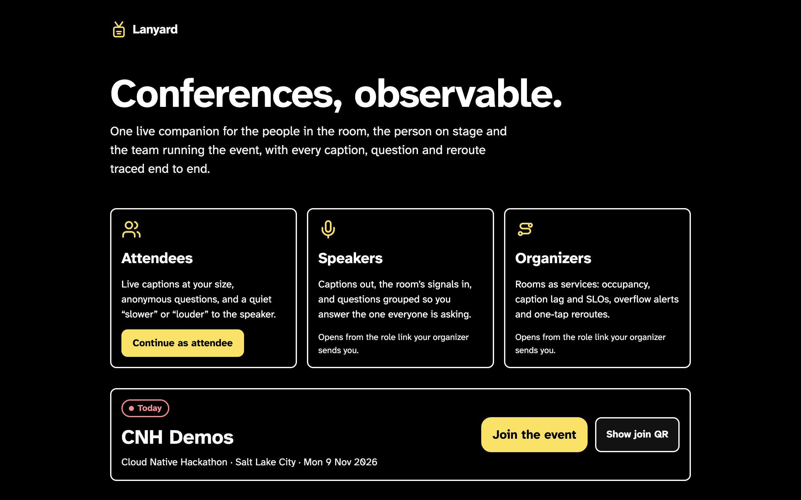
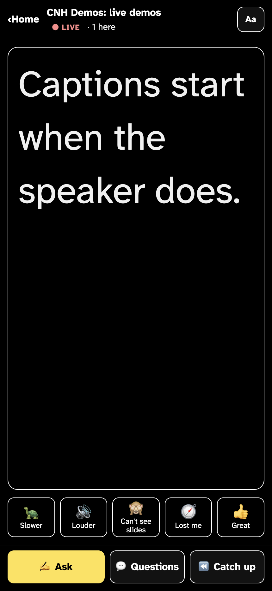
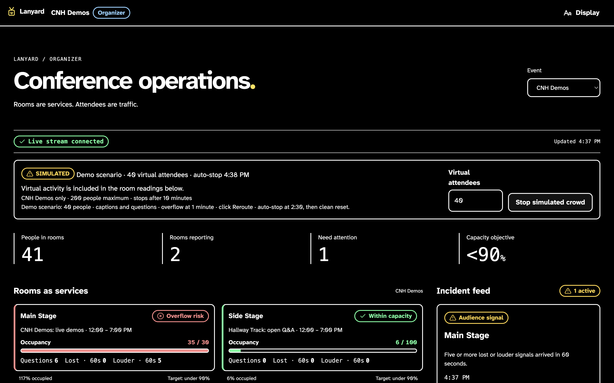
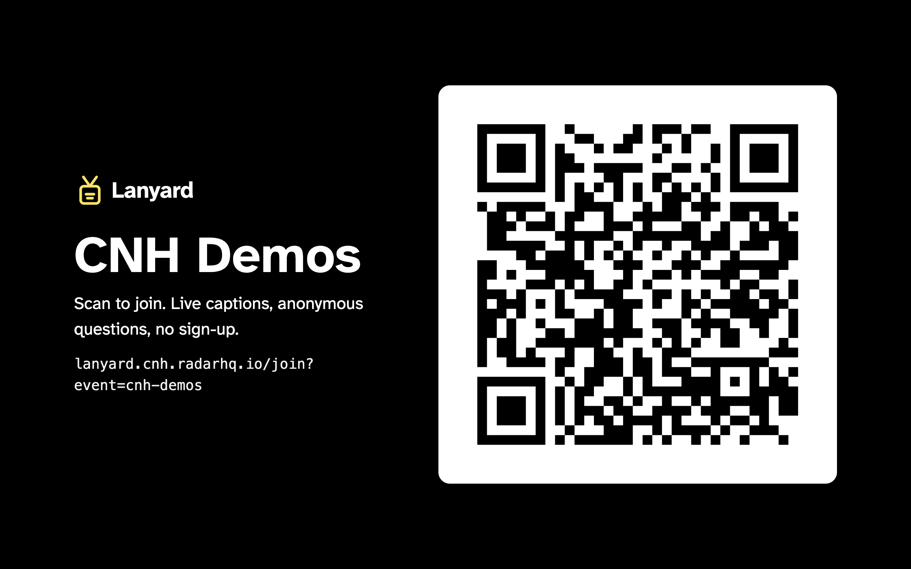
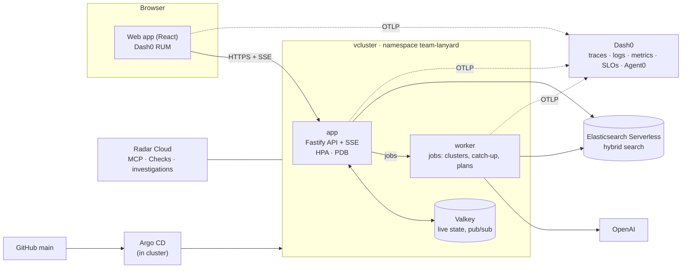

# Lanyard: Conferences, observable.

**A conference is a distributed system: rooms are services, attendees are traffic.**
Lanyard gives the people in the room live captions, anonymous questions and a quiet "slower / louder" to the speaker. It gives the speaker the room's signals and grouped questions, and gives organizers occupancy, SLOs, overflow alerts and one-tap reroutes.
Every caption, question and reroute is traced end to end with OpenTelemetry, from the attendee's phone to the cluster.

**Live:** https://lanyard.cnh.radarhq.io · built at the Cloud Native Hackathon, Salt Lake City, 9 Nov 2026.

| Landing | Attendee live session (phone) |
|---|---|
|  |  |
| **Organizer ops board: overflow alert (SIMULATED crowd)** | **Front-of-room join QR** |
|  |  |

## Try it

| Persona | Where | How to get in |
|---|---|---|
| **Attendee** | `/a` | Open https://lanyard.cnh.radarhq.io, choose **Join anonymously** (or scan `/qr/cnh-demos`). No sign-up, no personal data: you get a random handle. Open a live session for captions, signals, Ask, Questions and Catch up. |
| **Speaker** | `/s` | A role link from the organizer. |
| **Organizer** | `/o` | A role link. Rooms as services, SIMULATED crowd controls, overflow alerts with reroute, "Ask the conference", and links into the Dash0 dashboard, SLOs and Agent0. |

Role links are signed tokens in the URL fragment (`/join#t=…`). The app stores the token and strips it from the URL before RUM starts. Mint one locally (it prints only the link; never commit or share it):

```bash
npm run mint-link -- --role organizer --event cnh-demos --env-file .env   # or --role speaker
```

## Architecture



## Sponsor tracks

| Track | What we did | Evidence |
|---|---|---|
| **Radar** (AI SRE) | Ran and operated everything through Radar's MCP: GitOps syncs, Checks before and after, AI investigations of real incidents | [docs/evidence/RADAR.md](docs/evidence/RADAR.md), [INCIDENTS.md](docs/evidence/INCIDENTS.md) |
| **Dash0** | OpenTelemetry from browser RUM to app and worker; Conference Ops dashboard and 2 SLOs as code; Agent0 root-caused the 15 s stream cut | [docs/evidence/dash0/](docs/evidence/dash0/), [INCIDENTS.md](docs/evidence/INCIDENTS.md) |
| **Elastic** | Hybrid (BM25 + semantic) session search and verified citations for "Ask the conference" | [docs/evidence/ELASTIC.md](docs/evidence/ELASTIC.md) |
| **Gitar** | Gitar reviewed every PR with repo rules in `.gitar/`; every finding fixed or answered before merge | [docs/evidence/GITAR.md](docs/evidence/GITAR.md) |
| **Merge Forward** (accessibility) | Captions first; Atkinson Hyperlegible; dark, light and high-contrast themes; caption sizes up to XXL; reduced motion; polite live regions; never colour alone | [DESIGN.md](DESIGN.md); `docs/ACCESSIBILITY.md` arrives with WS6's PR #52 |
| AI usage | Who built what, with which agent and model | [docs/AI_USAGE.md](docs/AI_USAGE.md) |

Security notes: [docs/evidence/SECURITY.md](docs/evidence/SECURITY.md). Plan and contracts: [docs/plan/](docs/plan/).

## Run locally

```bash
cp .env.example .env      # fill in ES, Valkey, OpenAI, OTLP and TOKEN_SIGNING_KEY values; never commit .env
npm ci
npm run dev               # api, worker and web together
npm run typecheck && npm run lint && npm test
```

## Deploy (GitOps)

Merging to `main` runs the `build-and-deploy` GitHub Action. It builds the image to GHCR and commits `deploy: <sha> [skip ci]`. Argo CD inside the cluster then syncs `deploy/` (app, worker, Valkey, HPA, PDB) into namespace `team-lanyard`. Secrets live only in the Kubernetes Secret `app-credentials`, created outside git.

## Honest limits

- **Demo data is SIMULATED.** The organizer's crowd simulator drives occupancy, signals and the overflow alert, and is labelled SIMULATED wherever it shows.
- **Elasticsearch is a trial Serverless project**, so heavy search or "Ask the conference" bursts can hit its rate limits. The app degrades to a friendly "not available right now".
- **The platform gateway cuts every response at 15 s**, including server-sent events. Streams rotate cleanly at about 12 s with `Last-Event-ID` replay, so clients never see the cut ([Incident B](docs/evidence/INCIDENTS.md)).
- LLM features (question clusters, catch-up, plan my day) run in the worker or behind a cache and can take a few seconds.

## Platform

Built on the Cloud Native Hackathon's Radar AI SRE starter. The team's own vcluster (Radar lists it as `lanyard`), namespace `team-lanyard`, public URL `https://lanyard.cnh.radarhq.io` routed to Service `app` port 80. Argo CD, Argo Rollouts, Prometheus, CloudNativePG and Radar 1.19 come pre-installed: don't remove or upgrade them. Budget across the cluster: 2 CPU / 4 GiB requests, 4 CPU / 8 GiB limits, 4 PVCs / 20 GiB. The host refuses privileged, hostPath, hostNetwork and hostPID pods. Agent instructions are in [AGENTS.md](AGENTS.md); the deploy and debug procedures are in `.agents/skills/`.
