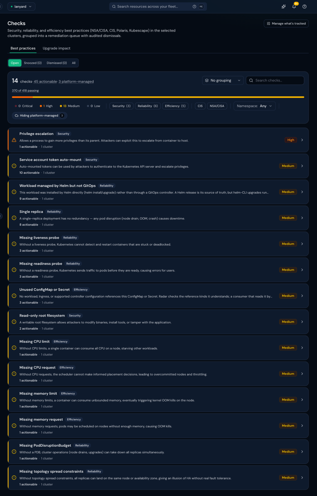

# Radar evidence

How the agents used Radar Cloud (MCP server `radar-cloud`, org "Cloud Native Hackathon") to observe and ship to the `lanyard` vcluster. Cluster id `kdJiSEnVNl0`; every call passes it as `cluster`. We never call `cnh` or another team's cluster.

## Tools available on this connection

`list_clusters`, `fleet_search`, `fleet_issues`, `fleet_list_gitops`, `fleet_list_packages`, plus the hosted AI investigation tools (`start_investigation`, `get_investigation`, `follow_up_investigation`, `list_investigations`, `stop_investigation`).

The per-cluster tools named in AGENTS.md (`get_cluster_audit`, `manage_gitops`, `diagnose`, `get_events`, `wait_for`) are **not** advertised on this connection. So the Checks "before/after" comes from the Radar Cloud UI (screenshots), and Argo CD syncs happen automatically on push (`selfHeal` + `automated`).

## Log

| Time (UTC) | Tool | Call | What it showed | Used for |
|---|---|---|---|---|
| 2026-11-09T18:33Z | `list_clusters` | (none) | 0 clusters, org "Lanyard" (MCP bound to the wrong org) | Fell back to read-only kubectl until Craig re-authenticated |
| 2026-11-09T18:48Z | `list_clusters` | (none) | Org "Cloud Native Hackathon"; `lanyard` = `kdJiSEnVNl0`, Radar 1.20.1, connected | Cluster id for every later call |
| 2026-11-09T18:49Z | `fleet_list_gitops` | `kind=applications, cluster=kdJiSEnVNl0, namespaces=team-lanyard` | Application `app`: Synced to `8e41d5f`, Healthy, last op Succeeded 2026-11-09T18:48:26Z | Verify the PR #1 deploy (ship skill, step "synced revision") |
| 2026-11-09T18:49Z | `fleet_search` | `q="kind:Pod ns:team-lanyard", include=summary` | 2/2 `app` pods Running 1/1 on image `ghcr.io/craigcossairt/lanyard:f8c3220` | Verify the live workload runs the new build |
| 2026-11-09T18:49Z | `fleet_issues` | `cluster=kdJiSEnVNl0, namespace=team-lanyard` | 0 issues | Baseline "before" for the team namespace |
| 2026-11-09T18:56Z | `fleet_list_gitops`, `fleet_search` | same as above | `app` Synced to `b2917c4`, Healthy; 2/2 pods on `1f80ab7` | Verify the #3 deploy |
| 2026-11-09T19:19Z | `fleet_list_gitops` | same as above | Synced to `9d35e73` (the #4 docs merge), not yet the #2 deploy commit `74ca0ac` | Argo hadn't polled yet, so we waited instead of declaring it deployed |
| 2026-11-09T19:20Z | `fleet_list_gitops` | same as above | Synced to `74ca0ac`, health **Progressing**, then **Healthy** at 19:20:43Z; resource count 3 → 5 | Verify the #2 deploy (Valkey + Secret wiring) |
| 2026-11-09T19:20Z | `fleet_search` | `q="ns:team-lanyard"`, CEL `filter: kind == "Pod" \|\| kind == "Deployment" \|\| kind == "Service"` | `app` 2/2 on `b1b0e69`; `valkey` 1/1 (`Recreate`), first seen `ContainerCreating` while the image pulled; Services `app:80`, `valkey:6379` | Confirm the new workload and that every `secretKeyRef` resolved (pods would sit in `CreateContainerConfigError` otherwise) |
| 2026-11-09T19:20Z | `fleet_issues` | same as above | 0 issues | No regressions after #2 |
| 2026-11-09T19:28Z | `fleet_list_gitops` | same as above | Synced to `b37bd5a` (deploy commit for WS0's skeleton #5), Healthy, last op Succeeded 19:26:30Z | Verify the monorepo skeleton deploy |
| 2026-11-09T19:28Z | `fleet_search` | `q="ns:team-lanyard"`, CEL `kind == "Pod" \|\| kind == "Deployment"` | `app` 2/2 on `ghcr.io/craigcossairt/lanyard:63f928d` (new pods, 1 min old); `valkey` 1/1 | The new one-image build runs as `ROLE=app` |

URL checks alongside: `https://lanyard.cnh.radarhq.io/` served `version f8c3220` at 18:49Z, `1f80ab7` at 18:56Z and `b1b0e69` at 19:20Z. At 19:28Z, after the skeleton, `/healthz` returned `{"status":"ok","role":"app","version":"63f928d"}` and `/readyz` returned 200. The Valkey pod events (kubectl, because the per-cluster `get_events` tool isn't on this connection) show the Docker Hub pull succeeded in 29.7 s with no rate limit, plus one expected readiness failure at start-up before Valkey bound its port.

## Checks (audit) before / after

`get_cluster_audit` isn't on this MCP connection, so Checks come from the Radar Cloud UI.

### Before: 2026-11-09T19:20Z (12:20 MT), all namespaces, platform-managed hidden

**14 checks, 45 actionable, 370 of 418 passing: 0 critical, 1 high, 13 medium.** (Taken just after #2 deployed Valkey, so Valkey's hardening is already in the baseline. The cutoff for a pre-#2 screenshot was missed.)

Which findings are ours? Each one is mapped to a workload from the live pod specs (kubectl, 19:30Z):

| Check (severity, count) | Our workloads in `team-lanyard` | Platform (pre-installed; leave alone per AGENTS.md) | Plan |
|---|---|---|---|
| Privilege escalation (High, 1) | none: `app` and `valkey` set `allowPrivilegeEscalation: false` | `monitoring/prometheus-server` | Not ours |
| Service account token auto-mount (Medium, 10) | `app` | Argo CD, Rollouts, CNPG, Prometheus, Radar, CoreDNS | Fix `app`; worker ships with `false` |
| Read-only root filesystem (Medium, 2) | `app` | `prometheus-server` | Fix `app` (emptyDir `/tmp`) |
| Missing PodDisruptionBudget (Medium, 1) | `app` | | Add PDB `minAvailable: 1` |
| Missing topology spread (Medium, 1) | `app` | | Add a soft spread by hostname |
| Single replica (Medium, 8) | `valkey` (by design) | Platform controllers | Accepted: one Valkey = one pub/sub bus; ES is the record |
| Workload managed by Helm but not GitOps (9), missing probes (3+3), missing CPU/memory requests or limits (1 each), unused ConfigMap/Secret (3) | none: every one of our containers has probes, requests and limits, and is GitOps-managed | Argo CD, Prometheus sidecar, `default/kubeconfig` (kept: kubectl access) | Not ours |

### After

Recorded after the worker + HPA PR and the Checks-fix PR deploy (screenshot plus the same table).
